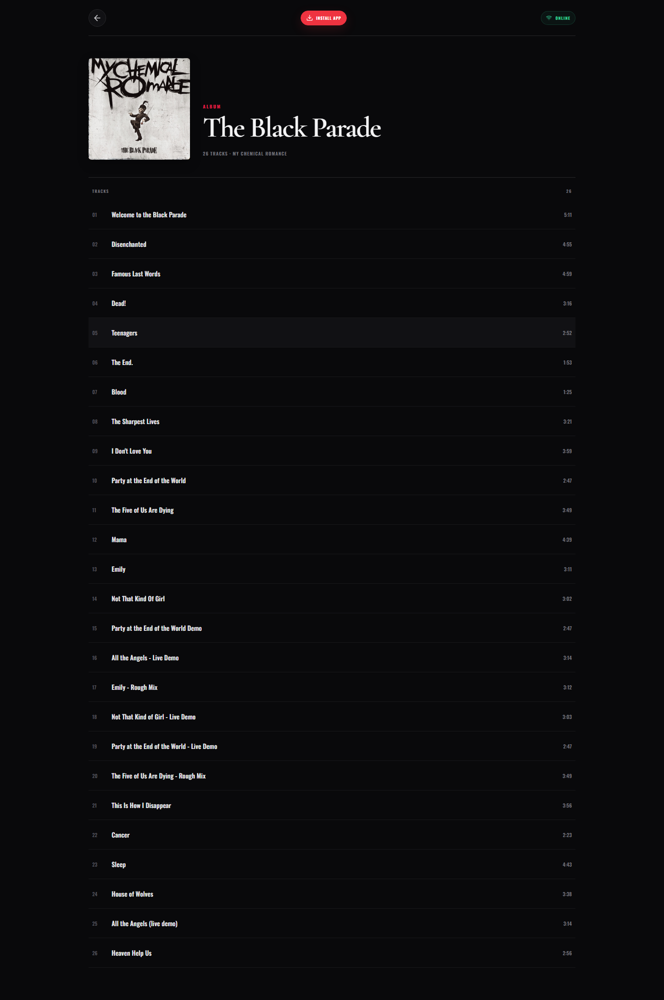

# MCR Offline Lyrics

A full-offline My Chemical Romance lyrics and discography PWA, styled with a **Live in Jakarta / The Black Parade** concert-poster theme.

**Live app:** https://alfatampan.github.io/mcr-offline-lyrics/

## Features

- Complete local MCR lyrics dataset
- Offline access after the first visit
- Instant fuzzy search across song titles, lyrics, and albums
- Album covers and dedicated album track pages
- Lyrics reader with Screen Wake Lock support
- Performance mode with front-camera recording and an adjustable scrolling lyrics teleprompter
- Installable PWA for Android, iPhone, iPad, Windows, and macOS

## Screenshots

The album browser, album detail, and lyrics-reader shots capture each complete page. The Library shot shows the mobile screen at normal viewport size; its track list scrolls like it does on a phone.

### Album browser


### Album details



### Library


### Lyrics reader


## Install on Android / Chrome

1. Open https://alfatampan.github.io/mcr-offline-lyrics/
2. Open Chrome's three-dot menu.
3. Select **Install app** or **Add to Home screen**.
4. Confirm by tapping **Install**.

You can also use the red **INSTALL APP** button in the app header. After installation, open MCR Offline Lyrics from the home screen or app drawer.

## Install on iPhone / iPad / Safari

1. Open https://alfatampan.github.io/mcr-offline-lyrics/ in Safari.
2. Tap the **Share** button.
3. Scroll down and tap **Add to Home Screen**.
4. Tap **Add**.

The app can also show its iOS installation instructions when you tap **ADD TO HOME**.

## Install on Windows / macOS

1. Open the app in Chrome or Edge.
2. Click the red **INSTALL APP** button in the header.
3. Alternatively, open the browser menu and choose **Install MCR Offline Lyrics**.

## Record while reading lyrics

1. Open a song's lyrics and tap **RECORD WITH LYRICS**.
2. Tap **ENABLE CAMERA** and allow camera and microphone access.
3. Adjust the lyrics scroll speed or tap **AUTO-SCROLL**.
4. Rotate your phone sideways for landscape, or tap **ROTATE PHONE** to request landscape when your browser supports orientation lock.
5. Tap **START RECORDING**; the camera preview and lyrics stay side-by-side on screen.
6. Tap **STOP RECORDING**, then **SAVE VIDEO**.

The downloaded clip contains the camera and microphone recording; the on-screen lyrics are a teleprompter and are not burned into that clip. To capture the lyrics on screen in your final video, use your phone's built-in screen recorder while Performance mode is open, or edit the saved camera clip with your preferred video editor. Camera recording requires a supported browser and permission; use the **ENABLE CAMERA** button on the live HTTPS site.

## Run locally

```bash
npm install
npm run dev
```

Open the local URL printed by Vite, typically `http://localhost:5173`.

## Production build

```bash
npm run build
npm run preview
```

The build output is written to `dist/`.

## Tech

- React
- Vite
- `vite-plugin-pwa` / Workbox
- Fuse.js
- Lucide React

## Credits and content

Lyrics data is credited to [LRCLIB](https://lrclib.net/), a free and open lyrics database, and its contributors. Thank you for making lyrics data available.

The MIT license in this repository covers the app's original source code only. Lyrics and album artwork are third-party content and are **not** relicensed under MIT; their respective copyrights and terms remain with their owners. Attribution is not a grant of rights.

## License

App source code is licensed under the [MIT License](LICENSE).
