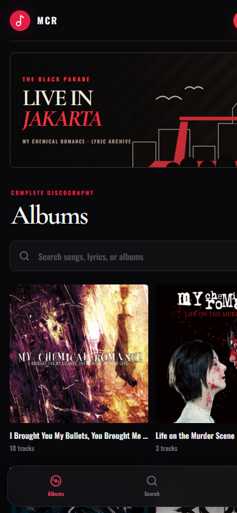

# MCR Offline Lyrics

A full-offline My Chemical Romance lyrics and discography PWA, styled with a **Live in Jakarta / The Black Parade** concert-poster theme.

**Live app:** https://alfatampan.github.io/mcr-offline-lyrics/

## Features

- Complete local MCR lyrics dataset
- Offline access after the first visit
- Instant fuzzy search across song titles, lyrics, and albums
- Album covers and dedicated album track pages
- Lyrics reader with Screen Wake Lock support
- Mobile-first Jakarta concert poster interface
- Installable PWA for Android, iPhone, iPad, Windows, and macOS

## Screenshots

### Desktop


### Mobile



## Install on Android / Chrome

1. Open https://alfatampan.github.io/mcr-offline-lyrics/
2. Open Chrome's three-dot menu.
3. Select **Install app** or **Add to Home screen**.
4. Confirm by tapping **Install**.

You can also use the red **INSTALL APP** button in the app header. After installation, open MCR Offline Lyrics from the home screen or app drawer.

## Install on iPhone / iPad / Safari

1. Open https://alfatampan.github.io/mcr-offline-lyrics/ in Safari.
2. Tap the **Share** button.
3. Scroll down and tap **Add to Home Screen**.
4. Tap **Add**.

The app can also show its iOS installation instructions when you tap **ADD TO HOME**.

## Install on Windows / macOS

1. Open the app in Chrome or Edge.
2. Click the red **INSTALL APP** button in the header.
3. Alternatively, open the browser menu and choose **Install MCR Offline Lyrics**.

## Run locally

```bash
npm install
npm run dev
```

Open the local URL printed by Vite, typically `http://localhost:5173`.

## Production build

```bash
npm run build
npm run preview
```

The build output is written to `dist/`.

## Tech

- React
- Vite
- `vite-plugin-pwa` / Workbox
- Fuse.js
- Lucide React

## License

Licensed under the [MIT License](LICENSE).
